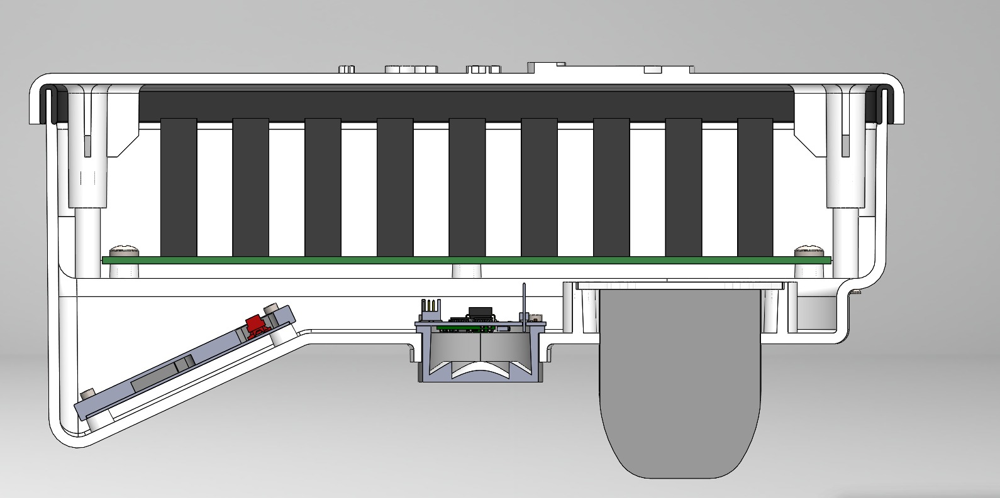
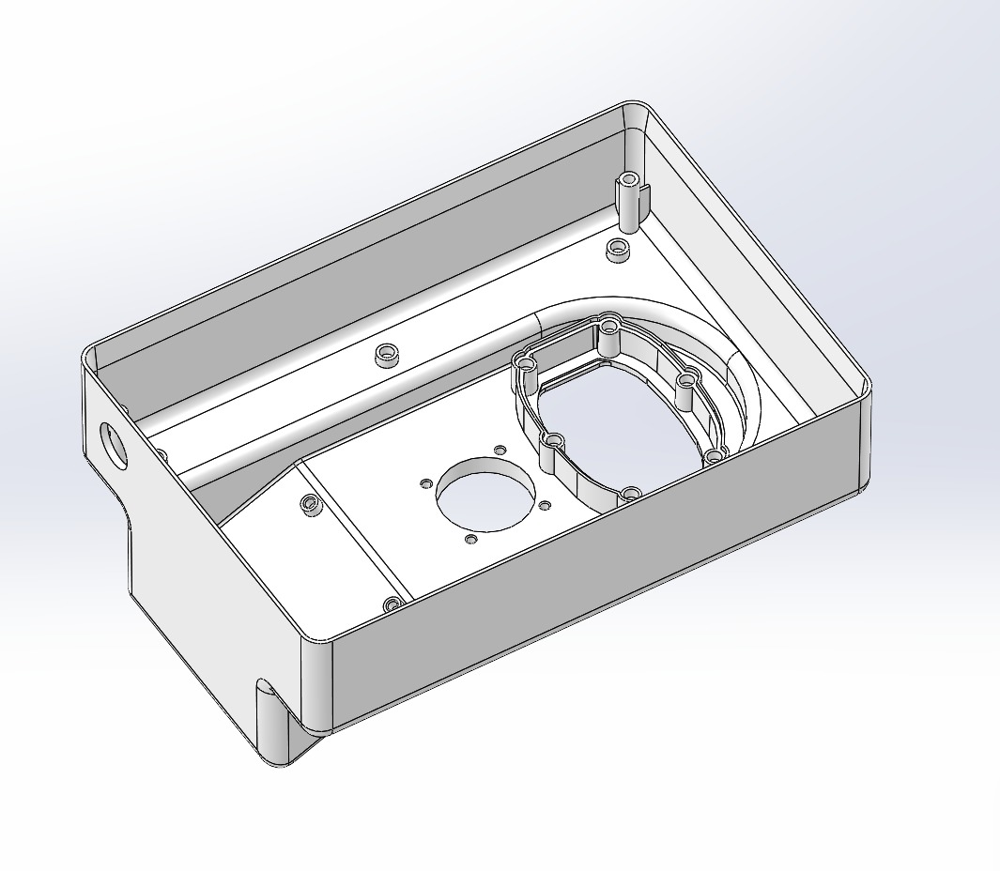
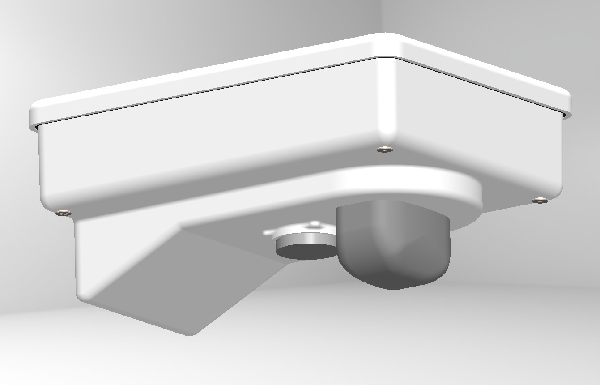

# DRISHTI – Radar Enclosure Redesign

## Product Design Internship | ClimMaTech | Sep - Oct 2026

Mechanical enclosure redesign for DRISHTI, a 24.125 GHz FMCW radar-based water monitoring system. The project involved developing the enclosure architecture and integrating internal components using Siemens NX, with emphasis on functional design, manufacturability, mounting provisions, and environmental protection.

## Project Overview

DRISHTI is a radar-based water monitoring system designed for water-level and surface-velocity measurement applications.

The objective of this project was to redesign its mechanical enclosure to accommodate the internal electronic components while providing a functional, compact, and manufacturable housing.

## Design Contributions

- Enclosure Architecture: Developed the mechanical enclosure layout and overall housing configuration.
- Component Integration: Worked on the internal arrangement and integration of electronic components within the enclosure.
- Mounting Provisions: Incorporated mounting interfaces and fastening provisions into the mechanical design.
- Design for Manufacturing: Considered manufacturability, assembly requirements, and practical design constraints.
- Environmental Protection: Incorporated enclosure features intended to protect internal components from external environmental conditions.

## CAD Visualisation

### Sectional View

Sectional representation of the enclosure, illustrating its internal arrangement and component integration.

### Internal Enclosure

Internal CAD view highlighting the component layout and enclosure architecture.

### External Enclosure

External CAD representation showing the overall enclosure geometry and housing configuration.

## Tools & Technologies

- Siemens NX
- 3D CAD Modelling
- Mechanical Design
- Product Development
- Design for Manufacturing (DFM)

## Internship Details

| **Detail** | **Information** |
|---|---|
| Organisation | CliMaTech |
| Role | Product Design Intern |
| Duration | September–October 2026 |
| Project | DRISHTI – Radar Enclosure Redesign |
| CAD Software | Siemens NX |
 

*This repository presents selected CAD visualisations and design work completed as part of the Product Design Internship at CliMaTech*
